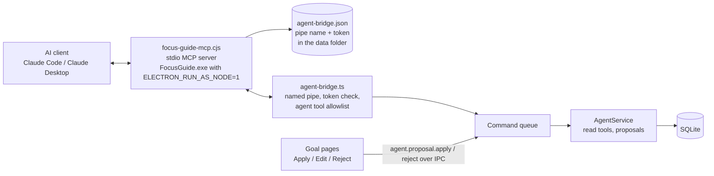
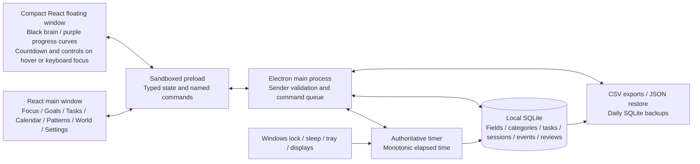
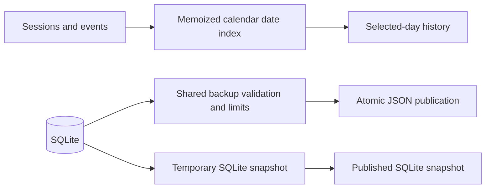

# Architecture — Focus Guide 2.0

## Learning workspace and local agent bridge (unreleased)

### Goal workspace

Goals is the first page. `App.tsx` keeps the open goal (`activeGoalId`), so the goal stays open when you go to Focus and back. `GoalWorkspace.tsx` has five sections: Overview, Roadmap, Tasks, Behaviour, and Plan & review. `focusGoal()` in `App.tsx` prepares a session with the goal, its area, an optional roadmap step and task, and the activity mode of the goal's latest session. The main process still owns all timing.

A field is still the parent of goals, tasks and sessions. The interface calls it an "area". Command names, tables and backup keys keep `field`.

### Behaviour profile

`goal.behaviour { goalId, from, to }` is a read command in `GoalService`. Activity samples are not part of `AppState`, so the main process computes the profile with `goalBehaviourProfile()` in `src/shared/behaviour-analytics.ts`. The Behaviour section and the agent bridge use the same function.

### Roadmap steps (schema 7)

Milestone bodies hold step details (estimate, target date, notes, links). `sessions.milestoneId` records the step when the session starts, with the same rule as the goal link: a to-do of the session's goal, fixed at the start. `roadmapEffort()` in `goal-planning.ts` sums recorded time for each step.

### Agent bridge and proposals (schema 8)



- The MCP server (`src/mcp/server.ts`) holds no data and never opens the database. It reads `agent-bridge.json`, sends one JSON line for each tool call to the named pipe, and returns the reply.
- `AgentBridge` (`src/main/agent-bridge.ts`) listens only while `settings.agentAccess` is not `off`. Each start makes a new random pipe name and a 256-bit token, and writes them to `agent-bridge.json` in the data folder. A request must carry the token, compared in constant time. Requests are limited to 64 KiB. The bridge accepts only the tools in `src/shared/agent-tools.ts`, never renderer commands. Each call runs in the command queue.
- `AgentService` (`src/main/agent-service.ts`) checks the access level again (`off` < `read` < `propose` < `edit`). Read tools return copies of records. Propose tools validate a payload against the current records and save an `agentProposals` row. They change nothing else.
- The user applies a proposal with `agent.proposal.apply`. The service validates the payload again, with the user's edits, then runs the normal commands (`goal.create`, `goal.milestones.sync`, `task.create`, `goal.action.save`, `goal.review.save`) and marks the proposal `applied` in one transaction. A roadmap proposal whose basis fingerprint no longer matches becomes `stale` and needs `confirmStale`.
- `AppState.agent` is a runtime-only status with the launch command for client configuration. It never reaches settings, datasets or backups.

- At the `edit` level (schema 9), `AgentEditor` (`src/main/agent-edits.ts`) runs the same validated commands at once. In one transaction it reads the changed fields, applies the change and saves an `agentChanges` record with the state before and after. The app writes the summary. The editor refuses deletion, `achieved` and `archived` goal status, step completion, and tasks without a goal, and allows 60 direct changes per hour. `agent.change.undo` puts back the earlier state through the normal commands and asks for confirmation when the record changed after the agent's change.
- Roadmap writes carry a revision (`roadmapRevision()` and `rowsRevision()` in `goal-planning.ts`). `update_roadmap` requires the revision from `get_goal`, and the editor in `MilestoneChecklist.tsx` sends the revision of the rows that it last saved. A stale `goal.milestones.sync` fails without a change, so an edit never archives rows that the agent added. Agent roadmap writes match rows by exact title only.

Invariants:

- Below the `edit` level, an agent never changes records directly. At the `edit` level, every agent change has an `agentChanges` record from the same transaction, and the user can undo it.
- An agent never deletes records, marks a goal achieved or archived, or ticks a roadmap step.
- Agent access is `off` after the schema 8 migration and after every restore.
- The pipe never accepts timer, deletion, restore, export or settings commands.

## Goal planning boundary (1.4.0)

`GoalService` adds validated commands for goals, milestones, actions, occurrences, progress, reviews and suggestion decisions. These commands use the existing bridge, which checks the sender and serializes commands. Store schema 4 keeps goal relationships in indexed columns. Flexible plans and revisions go in validated JSON bodies.

The app records the goal of a session when the session starts. It saves this goal and any pending occurrence in the same transaction. Later task edits do not change this goal. The main process continues to own timer accounting and optional activity collection.

Shared goal-planning functions:

- Project occurrences with dates from earlier schedule revisions. These revisions are immutable.
- Summarize effort separately from action records and outcome records.
- Apply the documented gates for duration and barrier suggestions.

The renderer uses the existing Radix controls and semantic tokens. Goals owns repeatable plans and their reviews. Tasks continues to be the editor for one-off tasks. Calendar shows planned actions as outlines, separately from the heat of recorded time. Patterns can filter sessions by goal. The isolated preview runs the same `GoalService` with atomic synthetic storage.

The migration takes a snapshot of the old SQLite database before its transaction starts. Backup format 4:

- Validates all goal collections and their relationships.
- Accepts versions 1–3 and gives them empty planning collections.
- Includes planning records in exports, restore previews and the recovery backup for field deletion.

For lifecycle, schedule and measurement semantics, see [Goal planning](GOAL-PLANNING.md).

### Activity timing (1.3.2)

Version 1.3.2 separates two cases:

- A malformed message from the input helper.
- A valid measurement that the app cannot place in authoritative active time.

When a timing anomaly occurs, the app drops the counters and leaves an "unavailable" gap. A timing anomaly does not disable the global shortcut, which operates independently. Each collection span records whether the app requested a start. If the helper becomes ready late, the app anchors one request to the current active time. It keeps the waiting period as "unavailable" coverage.

### Browser demo activity cursors

The browser demo saves an activity cursor for each session. The cursors are optional metadata next to the existing version-2 storage envelope. They are separate from the dataset fields and backup fields. If storage fails, deletion, simulation and cursor changes roll back together. Old demo profiles get default values for missing cursors. The demo discards activity rows that have no parent session.



## Invariants

- **One current item.** There is one current session or break at most. The main process serializes all commands. Two start requests at the same time cannot create two timers.
- **Monotonic time.** Elapsed focus time uses a monotonic clock. Renderer animation frames and window visibility never decide the recorded duration.
- **Durable intervals.** The recorded milliseconds of a session equal the sum of its durable active intervals. A checkpoint updates the current interval. It does not insert a duplicate interval every five seconds.
- **No extra time.** Paused intervals, breaks and interruption markers do not add focus time. Task checklist links do not multiply time.
- **Immediate transitions.** Each transition saves immediately. If a checkpoint fails, the timer freezes at the last durable total and shows an error. After a restart, recovery loads that durable total. When necessary, it creates a recovery flag and event. The timer stays paused.
- **Excluded sessions.** An excluded session stays in history and you can export it. It does not count toward analysis or neural progress. Archived fields keep their records.
- **Finish.** When a session finishes, one transaction saves the active interval, the completed record and the optional exclusion audit event.
  - If `activeMs < 120000`, the app sets exclusion automatically. A session of exactly two minutes is included.
  - `session.finish` accepts an optional validated `excluded` boolean for manual exclusion.
  - A later `session.exclude` command can reverse either choice. It does not change the intervals.
  - The app does not reclassify existing completed history.
- **Appearance settings.** Old metadata and version-1 backups can have no `theme` or `sidebarCollapsed` field. The app sets these to "light" and "expanded". Appearance toggles use the existing validated settings command and state broadcasts. Themes use shared CSS tokens. The floating timer keeps its transparent appearance with black lines in all themes.
- **Restore replaces.** Restore replaces the data. It never merges. Validation and a preview come first. Then the app saves a SQLite rollback snapshot and does the replacement in one transaction. If a write fails, the transaction rolls back.

## Source map

| Location | Responsibility |
|---|---|
| `src/main/index.ts` | Native windows, tray and power events, local protocol, sender checks, command queue, backup and export dialogs |
| `src/main/coordination.ts` | Serialized mutations, dialog preparation outside the queue, ownership of collector transitions |
| `src/main/timer.ts` | Clock, checkpoints, pause, resume and finish, recovery, break clock |
| `src/main/store.ts` | Prepared SQL statements, schema version 8, migration, persistence and restore transactions |
| `src/main/service.ts` | Validated application commands and business rules |
| `src/main/backup.ts` | Versioned JSON validation, atomic exports, safe CSV cells |
| `src/main/agent-bridge.ts`, `agent-service.ts`, `agent-edits.ts` | Local named-pipe endpoint for the MCP server, agent read tools, proposals with apply/reject, direct edits with their audit log and undo |
| `src/mcp/server.ts` | Stdio MCP server, bundled by `scripts/build-mcp.cjs` into `resources/mcp/focus-guide-mcp.cjs` |
| `src/shared/behaviour-analytics.ts`, `agent-tools.ts` | Goal behaviour profile; agent tool list and bridge file contract |
| `src/preload/index.ts` | Narrow `focusGuide` bridge |
| `src/shared/types.ts` | Dataset, state, command names and event interfaces |
| `src/shared/analytics.ts` | Local-date splits, filters, averages, Spearman calculation with tied ranks |
| `src/shared/demo.ts` | Invented example observations. It writes nothing to storage. |
| `src/renderer/src` | Seven main views (Goals opens a goal workspace), mini-window, progressive Three.js and SVG visuals, styles |
| `src/renderer/src/components.tsx` | Main-window `Brain`, compact `FloatingBrain`, icons, formatting and shared controls |
| `src/renderer/src/NeuralVisual.tsx`, `ThreeScene.tsx` | Local lazy loading of Three.js, bounded geometry, scene lifecycle and SVG fallback |
| `src/renderer/src/BrainScene.ts` | Procedural Focus brain: seeded fold geometry, progress shaders, lighting and per-frame update |
| `src/renderer/src/styles.css` | Responsive page hierarchy and visual overrides |

## Windows and rendering

The app saves the window bounds in local metadata. It clamps them to the connected displays at these times: on launch, when a display is removed, and when display metrics change.

Animation complexity is bounded. The app stops animation scopes when a renderer is hidden or when the user requests reduced motion. The default launch now permits hardware acceleration for the bounded Three.js scenes. If a scene fails, the app shows the SVG version. `--software-rendering` keeps the earlier compatibility path with software drawing. For lifecycle and graphics test requirements, see [Visual design](VISUAL-DESIGN.md). If the first-paint event of the hidden window does not arrive, startup shows the loaded page anyway.

### Themes and visibility

The main interface uses semantic CSS tokens for light mode and dark mode. Actions are purple and accents are blue. The root theme attribute follows the saved settings. The app sends it to both windows. The floating timer keeps its own readable ink tokens, black and light. Earned palette colors apply only to the world visual and its SVG fallback.

Chromium can report a hidden native window as visible. For this reason, the native show, hide, minimize and restore events publish a typed visibility event through the existing event subscription. This event controls only renderer motion. It never pauses or records focus time.

The main sculpture uses a bounded Three.js frame loop. Its SVG fallback keeps separate Anime.js scopes for drawing and ambient motion. Cleanup releases scene resources and animation scopes. All paths obey the live motion preferences. `AppState.graphicsMode` is a runtime-only field that reports the launch mode. The app does not put it in settings, datasets or backups.

### Floating brain

The floating window uses `FloatingBrain` to show the supplied local PNG through cropped SVG viewports.

Unreleased: `FloatingNetwork` replaces the sprite with the brain constellation of `NeuronScene.ts`, rendered through the same `ThreeScene` lifecycle as Focus (`kind: 'floating'`). Its formation value comes from `brainFormation` in `shared/timer-display.ts`. `FloatingBrain` stays as its fallback for software rendering and scene failure. [VISUAL-DESIGN.md](VISUAL-DESIGN.md) describes the formation rules.

- Eight aligned cells, in a sequence from pale to purple, blend by a bounded progress value: (elapsed − ten minutes) / (planned − ten minutes).
- Color stays at zero until minute ten. Color also stays at zero for plans of ten minutes or less.
- SVG saturation follows the same progress value. Thus the first sprite is grayscale.
- A four-second CSS breathing loop runs only while the timer runs and motion is enabled. Pause, reduced motion, disabled animation and hidden windows stop the loop.
- The app keeps the original 1028 × 1530 PNG. It does not edit its pixels.
- Hover and visible keyboard focus show the time and the controls. Focus from a mouse click alone does not keep them visible.
- The brain is the native drag region. The buttons use `no-drag`.
- The native bounds request a fixed size of 132 × 156. The app keeps saved positions, with a small margin at the display edge for Windows scaling.

The earlier update that added only the sprite added no commands, dependencies or migrations. Version 1.1.0 adds timing and Tasks interfaces and schema version 2. The section [Stopwatch, overtime and Tasks](#stopwatch-overtime-and-tasks-110) describes them.

### Floating window transparency

Only the floating `BrowserWindow` uses native transparency. It has a fully transparent background color and no window shadow. The renderer marks the floating document before it mounts React. Scoped CSS clears the backgrounds of the HTML, body, root and timer. It also resets the color scheme of the floating document. This also applies to the compact loading state. Light SVG and text shadows keep the black outlines and the controls visible on dark content. The main window keeps opaque surfaces in the selected light or dark theme.

## Inspect a database copy

You can use an isolated maintenance launch to inspect a **copy** of a SQLite snapshot that the app made. This launch does not touch the normal profile.

1. Make a new folder.
2. Copy the snapshot into the folder. Name the copy `focus-guide.sqlite`.
3. Open a new PowerShell session in the executable directory.
4. Run these commands. In the second line, use the path of your new folder.

   ```powershell
   $env:FOCUS_GUIDE_TEST_MODE = '1'
   $env:FOCUS_GUIDE_DATA_DIR = 'C:\FocusGuide-Recovery'
   Start-Process -FilePath '.\FocusGuide.exe'
   ```

5. Inspect the copied records.
6. Export a versioned JSON backup. Use this backup for the normal restore preview.

The folder must be writable. This mode replaces the normal application-data location before the app gets the instance lock. It does not bypass validation or renderer isolation.

## Official references

- The window controls use [Electron BrowserWindow](https://www.electronjs.org/docs/latest/api/browser-window/).
- Automatic pauses for lock and sleep use [powerMonitor](https://www.electronjs.org/docs/latest/api/power-monitor).
- Renderer restrictions follow the [Electron security guidance](https://www.electronjs.org/docs/latest/tutorial/security).
- The fallback SVG progress drawing in the main window uses [Anime.js createDrawable](https://animejs.com/documentation/svg/createdrawable/).
- The current floating sprite uses SVG cropping and blending, plus CSS breathing.

The exploratory coefficient is Spearman's rank correlation. Ties get average ranks. Its interpretation and its behaviour with constant input follow the [SciPy reference](https://docs.scipy.org/doc/scipy/reference/generated/scipy.stats.spearmanr.html). The app calculates the coefficient in TypeScript. It does not use SciPy. It shows no p-values and makes no claims of significance. References checked 2026-10-06 in America/Fortaleza.

## Review fixes: 1.0.1

Backup serialization and restore use the same `BACKUP_LIMITS` and the same validation.

Daily backup:

1. Catches errors when it sets up the directory.
2. Writes the SQLite snapshot to a temporary path, then publishes it.
3. Validates the JSON before its own atomic publication.

If validation or the snapshot fails, the previous usable backup stays. There is no schema migration.

Calendar makes an index from dates to sessions. It uses the sessions and their active intervals, each in the time zone in which the app recorded it. The renderer memoizes this index and the thought count of each session. Excluded sessions stay visible in history. Number summaries keep their existing rules.

Settings merges each broadcast with the last saved baseline. Thus, an appearance change does not discard unsaved changes in other fields. A successful restore resets that baseline explicitly.



## Stopwatch, overtime and Tasks (1.1.0)

Countdown, stopwatch and overtime are phases of the same authoritative session engine. A stopwatch has no planned duration.

- The engine records the `autoOvertime` value of a countdown when the countdown starts.
- At the threshold, the engine saves the active intervals and `targetReached` atomically. Then it requests one notification. It never creates a second session.
- Recovery after lock, sleep, quit or crash keeps the existing policy: you resume manually.
- The intervals still add up to `activeMs`. If a transition fails, the timer freezes at the durable checkpoint.

### Schema 2

SQLite version 2 adds task categories, task personalization and session timing fields.

1. Before it migrates version 1, `VACUUM INTO` saves a consistent snapshot. The snapshot includes committed WAL data.
2. One transaction does these steps:
   - Rebuilds the `sessions` table so that `plannedMs` can be null.
   - Adds the task columns and categories.
   - Checks the foreign keys.
   - Increments `user_version`.
3. If the migration fails, it rolls back.

Existing sessions keep their IDs, times and links. Their overtime is disabled. JSON version 2 normalizes version-1 inputs explicitly. Restore stays transactional.

### Tasks and Focus

The Tasks page owns creation, editing, categories, links and completion. `App` keeps the shared pending session selection. Focus stays mounted, so its preparation drafts stay. Its animation stops when the view is hidden. When you archive or complete a task, the app removes it from the pending choices. Active and historical links stay.

### Preview

The preview has its own Vite configuration. It binds only to 127.0.0.1. Its adapter is for development only. It uses the same engine and service with synthetic `localStorage` and a browser clock. It has no SQLite endpoint and no endpoint for personal data. Native commands tell you that they operate only in the desktop app. Production builds remove the preview adapter and its banner by tree-shaking.

### Rollback from schema 2

After the migration, a rollback needs the previous app AND its `before-schema-v2` SQLite snapshot. The previous binary alone rejects the newer database. Before you recover the old pair, keep a current version-2 export. The snapshot from before the migration does not contain the records that you made after it.

## Radix renderer design (1.2.0)

The renderer shares controlled Radix primitives through `src/renderer/src/ui.tsx`.

- Main-window portals use the document theme tokens.
- Dialogs stay mounted until their exit animations end.
- `AlertDialog` protects the confirmation of destructive operations.
- While a restore is pending, you cannot close its dialog.
- The wrapper encodes empty `Select` values internally. Stored domain values do not change.
- Settings stays mounted after your first visit, so unsaved drafts stay.
- Active Focus uses a quiet layout. Its existing preparation state and thought state stay in React.

This release does not change IPC, the schema, the backup format, the timer engine or the floating window.

## Behaviour collection boundary

### Native helper

`native/activity-helper.cpp` is a Windows x64 helper with static links. `scripts/build-helper.cjs` compiles it with MinGW. It does not need administrator rights or network access.

- Electron starts the helper hidden, from an absolute path in the packaged resources. It sends bounded commands through a pipe.
- A message-only window uses [Raw Input](https://learn.microsoft.com/en-us/windows/win32/inputdev/using-raw-input) for optional background totals of keyboard and mouse activity.
- The helper uses [RegisterHotKey](https://learn.microsoft.com/en-us/windows/win32/api/winuser/nf-winuser-registerhotkey) with `MOD_NOREPEAT` for the return controls.
- The helper never decodes text. It keeps key state for a short time only, to ignore repeated keys.
- When collection stops, the helper removes its device registration.
- If the parent process stops or the pipe closes, the helper exits.

### Main-process collector

`src/main/behaviour.ts` validates bounded aggregate messages. It ties each generation to authoritative active offsets. It stores only complete observations that are inside durable timer time.

- Clipped tails that the collector cannot place, and missing heartbeat periods, stay "unavailable". Disabled periods are explicit.
- Minute buckets merge adjacent records that have the same status.
- Aggregates flush together with checkpoints and transitions.
- Lock and sleep pause the timer immediately. Then the native flush drains the data. The drain adds no paused time.
- On quit, the app waits for queued commands. Then it pauses, drains and closes.
- A collector failure cannot stop a timer that operates correctly.

### Schema 3

Schema 3 adds:

- The activity mode and its version on each session.
- The active offset and the source on each marker.
- An indexed activity table with cascading deletes.

The app reads session samples only when it needs them. It does not send them in frequent state broadcasts. Full backups include them. The app exports them separately. The migration saves a consistent SQLite snapshot. Restore disables collection. When the JSON reaches its 64 MiB capacity, daily SQLite snapshots can still occur.

The previous app cannot read schema 3. A rollback must also use the matching database from before the migration. Keep newer records separately.

### Renderer feedback

`src/renderer/src/Behaviour.tsx` owns short-lived feedback and the review that you open on demand. An acknowledgement appears only after the marker and the timer boundary commit atomically. Hidden views discard acknowledgements. Feedback has no authority over timing.

## Shortcut configuration and centred brain

`ShortcutControl.tsx` records a supported key combination only through the recording button, while that button has focus. It edits the Settings draft. It keeps the existing checks for save conflicts and registration conflicts.

These events cancel the recording: Escape, blur, a hidden window, page navigation and a 30-second timeout.

The `shortcut.capture` command operates only from the main window. It temporarily sends the native shortcut, which is already registered, to a `shortcut-captured` acknowledgement. It does not record an attention return. It does not change the native registration. Blur, hide or reload of the main window also clears this mode. A 35-second native deadline ends abandoned requests. This feature records only a shortcut that you configure explicitly. It does not record other input content.

The feedback wrapper and its transform layer use the same centred grid and bounded height as the orbit. Thus the main brain stays aligned with the timer during idle, focus, pause and feedback. The dimensions and grayscale progression of the floating sprite have a separate scope.

## Architecture fixes: 11 October 2026

### File selection

The app prepares interactive file selection outside `CommandQueue`. The queue only commits the selected operation.

- Exports do a checkpoint and get the current data after you select the file.
- Restore preview and restore commit each check again that the app is idle.
- Input from the renderer never supplies a trusted file path.
- Sender checks run before preparation and again before commit.

### Transitions

`TransitionCoordinator` does these steps in sequence:

1. Drains collection.
2. Does a checkpoint of the timer.
3. Finalizes the span.
4. Commits a mutation.
5. Reconciles one time.

Settings and palette eligibility are validated before native registration or draining. If registration is rejected, collection does not change. If persistence fails, the coordinator keeps the buffered span. Periodic reconciliation cannot discard it. A later boundary operation can try again.

A system lock or suspend freezes the timer synchronously. Then the app puts the drain in the queue after the current transition. This keeps the durable clock boundary if Windows suspends before the asynchronous cleanup.

### Daily backup outcomes

The SQLite result and the JSON result of each daily backup are independent.

- If SQLite succeeds, the app advances `lastBackupDay` and the seven-date retention. This occurs even if JSON serialization fails.
- `lastJsonBackupDay` records a JSON success.
- `lastBackupJsonError` keeps the warning after a restart.
- After a SQLite success, automatic retries wait until the next day. **Back up now** tries both formats again.
- A failure to create the SQLite file is an operation failure.

No schema migration is necessary.

### Shortcut conflicts

The collector status shows the requested shortcut and the effective shortcut. It shows a registration error separately.

- If a restore causes a hotkey conflict, the app keeps the valid restored data.
- Settings shows the active key that the app kept. It also tells you to change the key or select **Retry shortcut**.
- During a conflict, you can still edit the other preferences.
- When you record an existing native shortcut, the app uses the effective key.

## Version 1.3.1: field deletion and page geometry

### Field deletion

The typed `field.delete` command takes a field id.

1. `FocusService` rejects a field that does not exist. It also rejects the deletion if any session is unfinished.
2. `FocusService` calls its required host backup callback.
3. The native host sends the deletion through the serialized transition coordinator.
4. The host creates a validated, atomic JSON backup at `backups/before-field-delete-<timestamp>-<uuid>.json`. If the backup fails, the deletion stops.
5. In one SQLite transaction, the store removes these items in this order:
   1. Sessions. Their events and activity rows are deleted by cascade.
   2. Tasks.
   3. The field.
   4. The saved activity-mode preference of the field.

Categories and unrelated history stay. No schema migration is necessary. The browser preview saves its recovery copy in synthetic `localStorage`. Then it does the same removal in one transaction.

### Settings dialog

Settings uses the shared dialog for destructive operations.

- It shows the impact on tasks, sessions and time.
- A ref prevents a second submission.
- While the deletion is pending, you cannot close the dialog.
- If an error occurs, the dialog keeps it so that you can try again.

A dataset with no fields is valid. Selection and filter cleanup follow the state broadcasts.

### Page geometry

- Main-window content has a shared maximum width of 1600px, with gutters of 18–32px.
- Workspace container queries stack the columns when the width is less than 900px.
- Field lists and Calendar history grow with the page scroll.
- Palette color passes down through the constellation groups. Field colors stay available in other places.

## Version 1.5.0: goal creation usability

### Schema 5

Goal and milestone records are JSON bodies, so schema 5 has no column changes. The migration saves a `before-schema-v5` snapshot with `VACUUM INTO`, then runs `upgradeGoalRecords` (`src/shared/goal-types.ts`) over goals and milestones and rewrites them in one transaction. The same function upgrades version 4 JSON backups and the browser preview's stored data. The previous app rejects a schema 5 database; a rollback needs the matching snapshot.

### Commands

- `goal.create` accepts `whyTags` and `milestones` (`{ title, completed }[]`, at most 100) and stores milestone positions in order.
- `goal.update` accepts `whyTags`.
- `goal.milestones.sync` replaces a goal's active checklist in one transaction and archives omitted milestones.

### Renderer

- `useDiscardGuard` (`ui.tsx`) routes every close path of an editor overlay (outside click, Escape, close button, Cancel) through one confirmation when the form differs from its initial snapshot.
- `TagPicker` (`ui.tsx`) and `MilestoneChecklist` / `GoalMilestones` (`MilestoneChecklist.tsx`) are the shared controls. Markdown parsing and formatting live in `src/shared/milestone-markdown.ts`.

## Milestone block editor (schema 6)

### Schema 6

Milestone records are JSON bodies, so schema 6 has no column changes. The migration saves a `before-schema-v6` snapshot with `VACUUM INTO`, then runs `upgradeGoalRecords` (`src/shared/goal-types.ts`) over the milestones and rewrites them in one transaction. The upgrade adds `kind: 'todo'` where it is missing. It is idempotent, so the same function serves JSON backups of versions 1–5 and the browser preview's stored data. The previous app rejects a schema 6 database; a rollback needs the matching snapshot.

### Invariants

- Only a `todo` milestone can be done, count for progress (`goalSummary`) or take a task link (`GoalService.taskLinks`, `validateGoalData`).
- `GoalService` refuses to change a to-do with linked tasks into another kind, in `goal.milestones.sync` and `goal.milestone.save`. It does not unlink tasks silently.

### Commands

- `goal.create`, `goal.milestones.sync` and `goal.milestone.save` accept `kind`. A row without `kind` is a to-do. A non-to-do row is saved with `completed: false`.
- `goal.milestones.sync` creates a milestone with the identifier that the renderer gives when no milestone has it yet, and refuses an identifier of another goal's milestone. The renderer makes identifiers with `crypto.randomUUID()`, so a repeated sync is idempotent.

### Renderer

- `MilestoneChecklist` (`MilestoneChecklist.tsx`) is a controlled block editor. Typed shortcuts come from `blockShortcut`; Markdown parsing, formatting, escaping and list numbering live in `src/shared/milestone-markdown.ts`.
- `GoalMilestones` runs one save at a time. A newer full-checklist save replaces a save that waits. While focus is inside the editor, the rows on screen stay the source of truth; the editor reloads from the dataset only after focus leaves and the saves finish. Inputs are not disabled during a save, so the caret stays in place.
