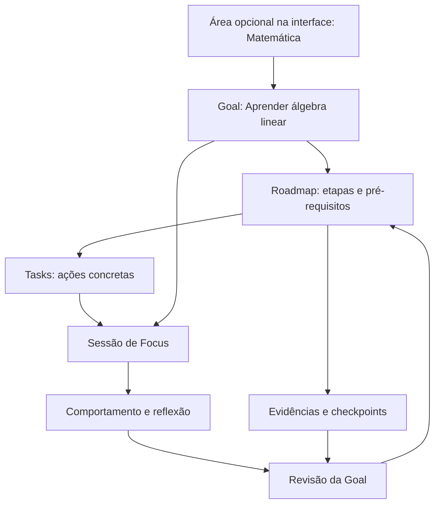
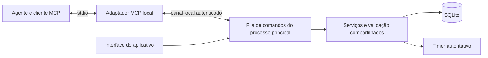

# Evolução para uma plataforma de acompanhamento do aprendizado

Data: 20/10/2026. Status: proposta de produto e arquitetura; funcionalidades novas ainda não implementadas.

## Direção e decisões

A Goal passa a ser o ambiente principal: define o resultado desejado, organiza o caminho e reúne execução, evidências e revisão. Focus é uma ferramenta disponível dentro desse ambiente. A experiência deve responder: o que quero aprender, qual é o próximo passo, o que fiz e o que já consigo demonstrar?

Decisões confirmadas pelo usuário nesta conversa:

- Aprendizado é o uso principal; objetivos de trabalho e pessoais continuam disponíveis.
- O agente conectado por MCP pode consultar dados e criar e editar Goals, roadmaps e tasks diretamente. A aplicação não deve exigir uma aprovação adicional para cada edição comum já autorizada.

As demais escolhas deste documento são recomendações de implementação. Não representam recursos já entregues nem um desenho visual aprovado.

## Base existente conferida

O código em `Arquivos/` declara versão 1.5.0 e esquema/backup 6. Já existem Goals, milestones ordenados com blocos de texto e checklist, ações recorrentes, observações numéricas, revisão semanal, tasks ligadas a Goal/milestone e sessões com Goal registrada no início. A navegação ainda começa em Focus.

| Base atual | Evolução proposta |
|---|---|
| Goal subordinada a um Focus Field | Goal como ambiente principal; Field apresentado como Área organizacional |
| Milestones em uma lista ordenada | Roadmap com etapas, tópicos, pré-requisitos e critérios de conclusão |
| Tasks editadas na página global | Mesmo registro editável no ambiente da Goal e na visão global |
| Focus selecionado por Field e tarefas | Início pela Goal, com etapa, tarefa e modo já preenchidos |
| Activity mode contextualiza a interação | Contexto preservado, acrescido de estratégia de estudo opcional |
| Tempo, check-ins e observações de resultado | Esforço, execução e evidências de aprendizagem apresentados separadamente |
| IPC interno do Electron | Adaptador MCP local para serviços e consultas delimitadas |

Fontes locais: [tipos de Goal](../../Arquivos/src/shared/goal-types.ts), [tipos gerais](../../Arquivos/src/shared/types.ts), [serviço de Goals](../../Arquivos/src/main/goal-service.ts), [navegação](../../Arquivos/src/renderer/src/App.tsx), [persistência](../../Arquivos/src/main/store.ts), [planejamento atual](../GOAL-PLANNING.md) e [coleta atual](../USER-GUIDE.md#behaviour-collection--version-130).

## Modelo do produto

Uma Área pode organizar várias Goals. Cada Goal tem um roadmap e pode ter tarefas avulsas além das tarefas ligadas a etapas. Uma sessão tem, no máximo, uma Goal e uma etapa principais para atribuição de tempo. Uma tarefa pode receber várias sessões. Evidências podem ser registradas sem sessão de Focus, inclusive após estudo em papel.

Na interface, a criação da Goal não depende de cadastrar uma Área primeiro. Durante a transição, o `fieldId` obrigatório pode ser resolvido por uma Área padrão, criada uma única vez. Os Fields existentes mantêm seus identificadores e histórico; a interface apenas muda sua posição na experiência. A retirada dessa obrigação do banco pode ser avaliada em outra migração.

## Experiência principal

**Página inicial — Goals.** Mostra objetivos ativos, próximo passo, revisões previstas e capacidade semanal compartilhada. O cartão oferece “Continuar” e “Iniciar Focus”. Goals pausadas e concluídas ficam acessíveis. Datas vencidas não transformam automaticamente uma Goal em fracasso.

**Dentro de uma Goal:** Visão geral, Roadmap, Tasks, Sessões, Aprendizado e Comportamento. Materiais ficam junto da etapa correspondente, com uma lista consolidada quando necessário. O botão de Focus está sempre disponível. A visão global de Tasks e o calendário reúnem os mesmos registros de todas as Goals.

**Criação progressiva.** Pedir título, tipo e resultado observável. Nível inicial, prazo, disponibilidade, materiais e critérios podem ser preenchidos depois. Para aprendizado, o resultado deve poder ser descrito como “consigo fazer X”. Para trabalho e vida pessoal, usar entregas e resultados apropriados ao objetivo.

**Sessão.** Goal → etapa/tarefa opcional → contexto e estratégia → duração ou cronômetro → Focus. As escolhas são herdadas da tarefa e continuam editáveis antes do início. A tela ativa mantém o ambiente calmo e o timer atual. Navegar para outra Goal não troca o contexto da sessão em andamento.

**Encerramento breve e opcional.** Registrar o que foi feito, uma dificuldade e o próximo passo. A pessoa pode adicionar uma evidência ou apenas encerrar. Concluir uma sessão não conclui automaticamente tarefa, etapa ou Goal.

## Roadmap e exemplo de álgebra linear

Recomendo começar com uma lista hierárquica editável e visualização clara dos pré-requisitos. Um editor livre de grafos pode vir depois. Cada etapa contém título, resultado esperado, pré-requisitos, materiais, tarefas, estimativa opcional e critério de conclusão. As estimativas ajudam a planejar; não são prazos calculados como certeza.

Exemplo ilustrativo de estrutura, a ajustar ao nível e à finalidade do usuário:

| Etapa | Resultado observável | Atividades possíveis | Evidência possível |
|---|---|---|---|
| Vetores e operações | Representar e combinar vetores | Leitura, desenho e exercícios | Resolver exercícios e explicar a combinação linear |
| Sistemas e matrizes | Resolver sistemas e interpretar soluções | Exemplos resolvidos e prática independente | Solução comentada, incluindo um sistema sem solução única |
| Espaços, base e dimensão | Verificar independência e construir bases | Problemas e explicação de conceitos | Justificativas de exemplos e contraexemplos |
| Transformações lineares | Relacionar matrizes e transformações | Visualização e problemas | Explicação geométrica e cálculo correspondente |
| Autovalores e aplicações | Resolver um problema alinhado à finalidade da Goal | Exercícios e pequeno projeto | Artefato final e explicação das escolhas |

Um tópico pode depender de outro. O sistema rejeita dependências circulares. Os estados de execução podem ser “não iniciado”, “em andamento”, “bloqueado” e “concluído”; a necessidade de revisão é um sinal separado, porque uma etapa concluída pode precisar ser retomada.

Reordenar ou revisar o roadmap preserva identificadores, tarefas e referências históricas. Retirar uma etapa com histórico a arquiva. Alterar o critério de conclusão cria uma revisão: uma evidência antiga continua ligada ao critério sob o qual foi produzida.

## Features que acompanham a nova direção

| Feature | Utilidade concreta | Prioridade |
|---|---|---|
| Ambiente por Goal | Reúne contexto, roadmap, tasks e Focus no mesmo lugar | Fundação |
| Próximo passo | Mostra tarefas prontas, revisões pendentes e dependências, explicando a ordem | Fundação |
| Materiais por etapa | Guarda links, referências locais e notas junto da atividade | Fundação |
| Evidência de aprendizagem | Registra solução, explicação, resultado ou pequeno projeto associado a um critério | Fundação, versão simples |
| Diário breve de estudo | Guarda dificuldades e um ponto claro para retomar a próxima sessão | Fundação |
| Checkpoints de aprendizagem | Compara tentativas usando critérios explícitos e registra ajuda/consulta utilizada | Segunda entrega |
| Fila de revisão | Agenda retomadas editáveis e registra quando e como foram realizadas | Segunda entrega |
| Caderno de erros e dúvidas | Liga uma dificuldade à etapa, à tentativa e à próxima ação de revisão | Segunda entrega |
| Planejamento por disponibilidade | Distribui compromissos entre Goals sem ignorar tarefas ainda sem estimativa | Segunda entrega |
| MCP com edição direta | Permite ao agente criar e revisar o plano usando o histórico selecionado | Segunda entrega, contrato previsto na fundação |
| Experimentos pessoais | Compara estratégias escolhidas pelo usuário com contexto e limites visíveis | Posterior |
| Mapa de competências | Mostra conceitos, relações e evidências para cada capacidade | Posterior |
| Portfólio/exportação da Goal | Reúne roadmap, produções e histórico em formato portátil | Posterior; backup completo desde a fundação |

Na fila de revisão, começar com datas sugeridas e ajustáveis, registrando a regra utilizada. Não prometer uma data ótima de memorização. Testes de recuperação, explicações e revisão distribuída têm apoio em pesquisa educacional; o desenho específico do aplicativo ainda precisará ser avaliado. A página de recomendações do [guia do IES/WWC](https://ies.ed.gov/ncee/wwc/PracticeGuide/1) sustenta essa orientação geral; foi consultada a página, não realizada uma revisão integral dos estudos.

O progresso deve apresentar três dimensões independentes:

- **Esforço:** tempo registrado e distribuição das sessões.
- **Execução:** tarefas, etapas e revisões realizadas.
- **Aprendizagem:** evidências associadas aos critérios, data da última tentativa e necessidade de nova avaliação.

“60% das etapas concluídas” não significa “60% de domínio”. Autoavaliação de confiança, acerto em exercício e avaliação por IA são registros distintos. Sem evidência, apresentar “ainda não avaliado”. A visualização neural pode celebrar constância e marcos, mas não deve representar crescimento cerebral ou medição cognitiva.

## Activity mode e Behaviour por Goal

Preservar os modos atuais: Reading, Writing/coding, Visual work, Video/lecture, Offline, Mixed e Unspecified. São contextos de interação. Acrescentar uma estratégia opcional de aprendizado: exploração, resolução de exercícios, recuperação de memória, explicação, revisão ou projeto. Um preset pode preencher os dois campos sem exigir duas decisões a cada sessão.

Exemplos: “Offline + resolução de exercícios” e “Writing/coding + resolução de exercícios” representam a mesma estratégia em contextos diferentes. Um modo padrão na Goal ou na tarefa é uma preferência; cada sessão guarda o valor efetivamente selecionado. Sessões antigas não recebem estratégias inferidas.

O painel da Goal pode mostrar tempo por etapa e estratégia, frequência, pausas, retornos autodeclarados, energia/foco autodeclarados, dificuldades e evidências produzidas. Comparações usam períodos e contextos explícitos, quantidade de sessões e cobertura da coleta. Taxas de teclado/mouse usam apenas o tempo observado correspondente; ausência de coleta não vira zero.

Limites definidos pela coleta atual:

- Teclas, cliques, rolagens e intervalos com movimento são totais agregados; não revelam aprendizagem.
- A aplicação não coleta texto digitado, nomes de aplicações ou conteúdo de páginas. Logo, não pode informar quais sites causaram distração.
- Pouca interação pode ser compatível com leitura ou atividade em papel.
- “I'm back” registra o retorno declarado; não mede o começo nem a duração da distração.
- Padrões observados podem orientar uma hipótese pessoal, sem estabelecer causalidade ou diagnóstico.

As sugestões existentes por Field e Activity mode precisam ser revistas para a nova granularidade. A análise por Goal deve mostrar quando a amostra é insuficiente. Qualquer comparação ampliada à Área precisa ser explícita, sem apresentar dados de outras Goals como se fossem daquela Goal.

## MCP local

O aplicativo será o servidor de capacidades; o agente externo será o consumidor. O agente pode propor conteúdo e interpretar dados recebidos. Persistência, cálculos descritivos e validação continuam no aplicativo. Não é necessário integrar um chat ou um modelo remoto ao núcleo do produto.

A documentação oficial descreve `stdio` como transporte entre processos locais. Recomendo um adaptador MCP iniciado pelo cliente de IA e conectado ao processo principal do aplicativo por um canal local controlado. A seleção da versão do SDK e do protocolo deve ser feita na implementação, verificando a compatibilidade do cliente utilizado. Fonte: [arquitetura do MCP](https://modelcontextprotocol.io/docs/learn/architecture).

No Windows, avaliar named pipe com acesso limitado ao usuário e credencial revogável por cliente. Nenhuma porta de rede é necessária para esse desenho. O adaptador não abre um segundo escritor direto no SQLite. Na primeira implementação, o aplicativo precisa estar em execução, inclusive na bandeja; caso contrário, responder `APP_UNAVAILABLE`. Inicialização automática ou um serviço independente exigiriam uma decisão posterior de ciclo de vida.

Ferramentas propostas — nomes ilustrativos, ainda não implementados:

| Grupo | Exemplos | Resultado |
|---|---|---|
| Contexto | `goals.list`, `goals.get`, `roadmaps.get`, `tasks.list` | Dados delimitados, paginados e com revisão |
| Edição | `goals.create`, `goals.update`, `roadmaps.apply_changes`, `tasks.upsert_many` | Alteração direta, IDs, nova revisão e resumo do que mudou |
| Aprendizado | `learning.record_evidence`, `learning.list_checkpoints`, `reviews.schedule` | Evidência com autoria e critério, checkpoints e revisões |
| Comportamento | `behaviour.summary`, `sessions.list` | Medidas determinísticas, período, filtros, cobertura e referências |
| Preparação | `focus.prepare` | Goal/tarefa pronta para iniciar na interface |
| Histórico | `changes.list`, `changes.undo` | Auditoria e reversão de alterações compatíveis |

Cada mutação usa identificador de solicitação persistente para evitar duplicação em retries. Edições exigem a revisão esperada; conflito retorna a versão atual sem sobrescrever silenciosamente. Uma criação composta de Goal, roadmap e tasks deve confirmar tudo em uma transação ou não criar nada. O retorno precisa ser suficiente para o agente informar exatamente o que foi alterado.

A conexão pode autorizar edição direta de planejamento, conforme a preferência confirmada pelo usuário. O app mostra clientes habilitados, escopo de Goals e acesso a dados comportamentais, além de permitir revogação. O histórico distingue pessoa e agente. Desfazer é uma nova operação validada e não apaga alterações posteriores de outra origem; conflitos exigem reconciliar a edição.

O MCP inicial não precisa expor SQL, shell, exclusão definitiva, restauração do banco nem fabricação de tempo de foco. `focus.prepare` não inicia tempo em nome da pessoa. Essas restrições delimitam o contrato proposto, sem limitar a edição direta de Goals, roadmaps e tasks solicitada.

Resumos são a resposta padrão para comportamento. Notas livres, evidências detalhadas e conteúdos de arquivos exigem escopo próprio. Referenciar um arquivo em uma etapa não autoriza ler o restante da pasta. Se forem acrescentadas leituras, restringir caminhos, tipos e tamanho e tratar conteúdo como dados, nunca como instruções para executar ferramentas.

**Localidade:** banco e servidor locais não garantem que o processamento do agente seja local. Se o cliente usar um modelo em nuvem, os dados enviados ao agente podem ser processados fora do computador. A configuração deve explicar esse caminho. Operação inteiramente offline requer também um agente/modelo local compatível. A documentação de [arquitetura do MCP](https://modelcontextprotocol.io/docs/learn/architecture) separa o protocolo da forma como o host utiliza modelos e contexto.

Exemplos de pedidos que esse contrato permitirá:

> Crie uma Goal para aprender álgebra linear, com quatro horas disponíveis por semana. Monte um roadmap inicial e tarefas para a primeira etapa, indicando as suposições sobre meu nível.

> Consulte as sessões de álgebra linear das últimas quatro semanas. Separe prática de exercícios de consumo de conteúdo e mostre o que os dados permitem concluir.

> Atualize as tarefas futuras para priorizar minhas dúvidas sobre independência linear. Preserve o que já foi concluído e programe uma revisão.

## Impacto no modelo de dados e no código

| Parte | Mudança proposta |
|---|---|
| Goal | Tipo de objetivo, contexto inicial, disponibilidade e preferências; Goals antigas ficam sem tipo até classificação explícita |
| Roadmap | Etapas estáveis, relação pai/filho, pré-requisitos sem ciclos e revisões de critérios |
| Task | Ligação opcional com etapa e estratégia sugerida; mesma entidade em todas as telas |
| Session | Etapa e estratégia capturadas no início; manutenção de Goal, modo e demais vínculos históricos |
| Aprendizado | Evidência, tentativa/checkpoint, critério versionado, autoria e condições da tentativa |
| Materiais | Links e referências locais vinculados a Goal/etapa; política explícita para anexos |
| Revisão | Agenda de retomadas e registros de realização, separados das revisões de planejamento semanal |
| Integração | Revisões, solicitações idempotentes, autorizações por cliente e histórico de alterações |

Reaproveitar `GoalService`, `FocusService`, `CommandQueue`, `TimerEngine`, validações compartilhadas e controles de `ui.tsx`. A interface e o MCP chamam a mesma camada de aplicação. Adicionar módulos delimitados de roadmap, evidências e integração em `Arquivos/src/`; não concentrar toda a expansão em `App.tsx` ou duplicar o serviço de Goals no adaptador.

O backup deve incluir todas as novas entidades duráveis e suas referências. Credenciais MCP ficam fora das exportações. No primeiro recorte, referências a arquivos não significam cópia do arquivo para o backup; isso deve estar visível. Se houver anexos gerenciados posteriormente, o pacote de exportação precisa incluí-los e validar integridade.

## Red Team antes da implementação estrutural

Este é o check prévio solicitado por `AGENTS.md` para migrações, segurança e grandes refatorações. A presente alteração é apenas documentação; nenhuma migração ou operação sobre dados pessoais foi executada.

| Falha possível | Suposição e alternativa mais segura | Validação e recuperação |
|---|---|---|
| Converter Fields em Goals e atribuir histórico incorreto | Um Field pode conter várias Goals. Preservar IDs e usar Fields como Áreas | Conferir contagens, vínculos e duração total antes/depois; snapshot consistente antes da migração |
| Converter blocos de checklist em competências inventadas | Texto e checkbox não provam domínio. Preservar conteúdo, tipo e ordem; adicionar estrutura sem inferir evidência | Fixture sintética com todos os tipos de bloco; rollback transacional |
| Edição pelo agente sobrescrever trabalho da pessoa | Cliente pode estar desatualizado. Exigir revisão e serializar mutações | Simular edições simultâneas, retry e falha parcial; conflito sem perda silenciosa |
| Reorganizar tasks alterar atribuição passada | Contexto histórico precisa permanecer estável | Registrar etapa/estratégia no início; verificar que religações futuras não movem sessões antigas |
| Dados incompletos produzirem falsa conclusão | Coleta pode estar desligada ou indisponível | Testar cobertura parcial, zeros observados e dados ausentes; exibir limites |
| Agente ganhar acesso excessivo | Cliente habilitado não precisa de todo o perfil | Escopos, revogação e consultas delimitadas; testar cliente não autorizado e leitura fora do escopo |
| Recuperação apagar dados criados após atualização | Binário antigo pode não ler novo esquema | Guardar exportação atual; restaurar app e snapshot compatíveis, explicando o período que ficará fora da restauração |

A migração deve ser aditiva quando possível, versionada e precedida de snapshot SQLite consistente. O número do próximo esquema será escolhido contra o estado do código no momento da implementação. Backups legados continuam importáveis por normalização explícita. O preview usa exclusivamente dados sintéticos e não oferece acesso MCP ao perfil pessoal.

## Entregas e critérios de conclusão

**1. Fundação centrada em Goals.** Página inicial, ambiente da Goal, roadmap em lista, Tasks e Focus integrados, estratégia opcional e registro simples de evidência. Incluir desde essa entrega os IDs, revisões e serviços necessários ao MCP. Aceite: criar a Goal de exemplo, adicionar uma etapa e tarefa, realizar uma sessão e registrar uma evidência; ver tudo no ambiente correto e preservar histórico anterior.

**2. Agente e ciclo de aprendizagem.** MCP com consulta e edição direta, auditoria/reversão, checkpoints, fila de revisão e comportamento por Goal. Aceite: criar Goal/roadmap/tasks em lote por um cliente real; repetir a chamada sem duplicação; detectar conflito com edição na interface; consultar somente o escopo autorizado; restaurar um backup com as novas entidades.

**3. Orientação personalizada.** Planejamento por capacidade, caderno de erros integrado, experimentos pessoais e mapa de competências. Aceite: cada sugestão apresenta dados de apoio, lacunas e possibilidade de ajuste; mudanças afetam planos futuros sem reescrever evidências passadas.

Verificações da implementação: `npm.cmd run typecheck`, build e package a partir de `Arquivos/`; checagens dirigidas de migração/restore, integridade de relações, concorrência MCP e recuperação do timer; navegação por teclado e telas em dados sintéticos. Respeitar a regra do repositório sobre não acrescentar suítes ou relatórios ao workspace, utilizando um ambiente temporário isolado quando forem necessários cenários automatizados. Atualizar `Aplicativo/` apenas com o app totalmente encerrado e um caminho de rollback preparado.

A primeira entrega deve formar um ciclo completo: **definir → planejar → praticar → registrar evidência → revisar**. Isso dá ao produto uma função de acompanhamento do aprendizado desde o começo.
