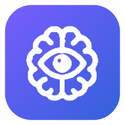
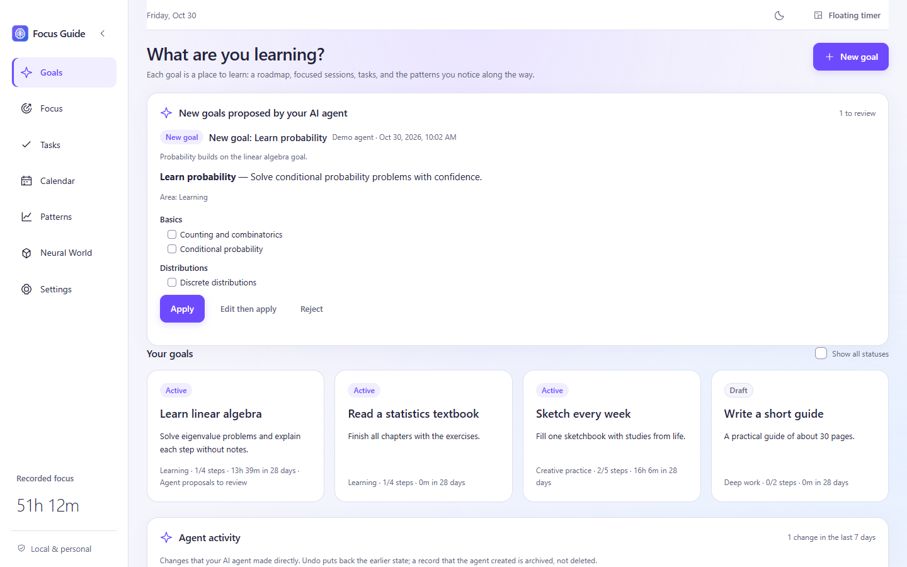
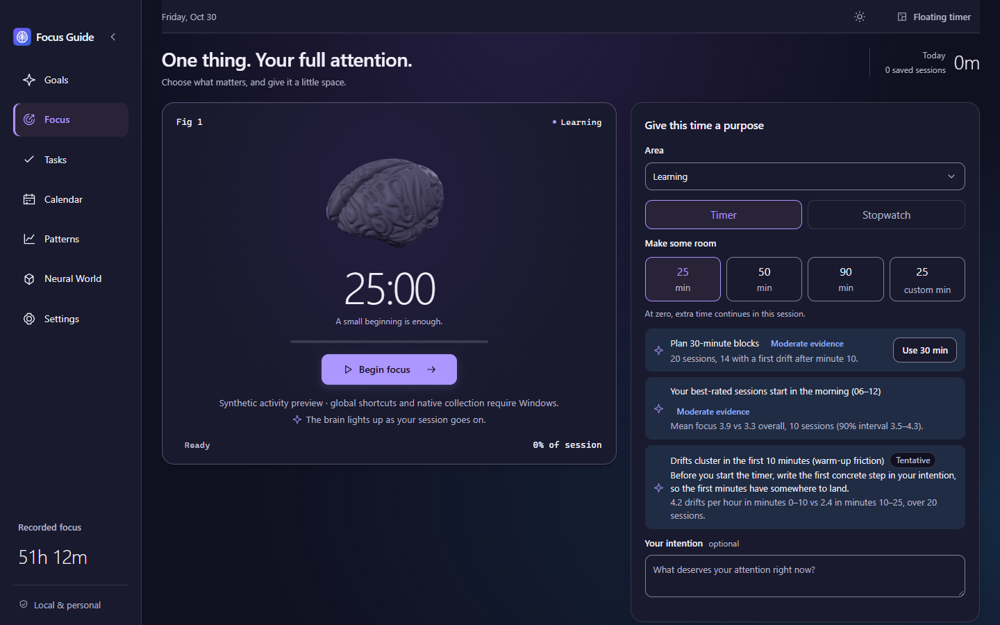
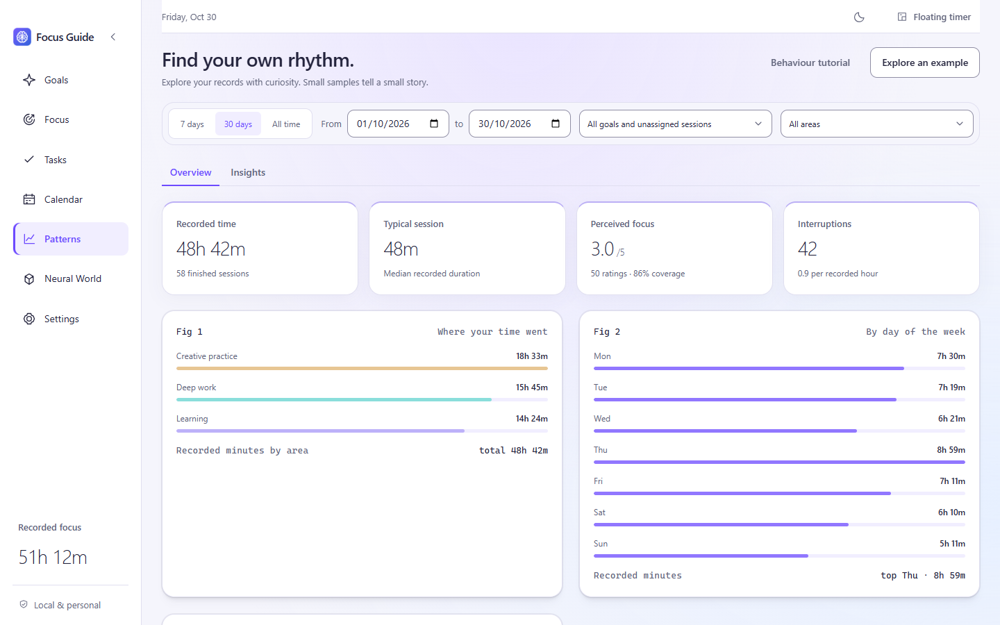

<p align="center"></p>

<h1 align="center">Focus Guide</h1>

<p align="center">A local-first Windows app that records your focus sessions, goals, tasks and behaviour, and shows you the patterns in them.</p>

<p align="center">
  <a href="LICENSE"></a>
  
  
</p>



## What it does

- **Focus sessions.** A countdown or a stopwatch, with breaks, overtime and a floating timer that stays on top of other windows. Only the main process measures time, so a slow window never changes a recorded duration.
- **Goals and roadmaps.** Each goal has an outcome, a roadmap of steps, planned actions, tasks and a weekly review.
- **Patterns.** Charts of where your time went, by day, by area and by activity mode. The Insights tab shows your day rhythm, attention span and focus model, with the evidence and the sample size for each result.
- **Behaviour (optional).** Keyboard and mouse activity summaries, attention check-ins and reflection questions. The app never records keystrokes or screen content.
- **Neural World.** A 2D map of your areas, goals and finished sessions that grows with your recorded time.
- **AI agent integration (optional).** An MCP server lets an agent such as Claude Code or Claude Desktop read your records, propose plans and, if you allow it, edit them. You choose the access level: `off`, `read`, `propose` or `edit`. Every agent edit is audited and you can undo it.
- **English and Brazilian Portuguese**, light and dark themes.

| Focus (dark theme) | Patterns |
|---|---|
|  |  |

## Your data stays on your computer

Focus Guide keeps all records in a local SQLite database in `%APPDATA%\Focus Guide`. The app has no account, no telemetry and no network service. It makes daily backups and takes a snapshot before each schema migration. You can export a JSON backup or a CSV file at any time.

If you connect an AI agent that uses a cloud model, the data that the agent reads goes to that model provider. Agent access is `off` by default, and the Settings page explains each level before you turn it on.

## Install

Focus Guide runs on Windows 10 and 11 (x64).

1. Download the latest build from the [Releases](https://github.com/lucasprac/focus-guide/releases) page, or build it from source (see below).
2. Extract the folder and open `FocusGuide.exe`. Keep all files of the folder together.
3. If the window shows graphics problems, fully quit the app from its tray icon and run `Start-Software-Rendering.cmd`.

Closing the main window keeps the app in the tray, so a running session continues. Use **Quit** in the tray menu to stop the app.

## Build from source

Requirements: Windows x64, Node.js 22 or later and npm. To build the optional activity helper, you also need MinGW C++ (`g++`). Run all commands from `Arquivos/`:

```powershell
npm.cmd ci
npm.cmd run typecheck   # the verification gate
npm.cmd run dev         # start the app in development mode
npm.cmd run package     # writes the app to Arquivos/dist/win-unpacked
```

To look at the interface without your personal data, run `npm.cmd run preview` and open `http://127.0.0.1:4173/?preview=1`. The preview uses synthetic data in browser storage.

See [Development](Docs/DEVELOPMENT.md) for the prerequisites, the browser preview, the MCP server tests and packaging.

## Repository layout

| Folder | Contents |
|---|---|
| [`Arquivos/`](Arquivos/) | Source code (Electron, React 19, TypeScript, better-sqlite3), build scripts, the native Windows activity helper and the Rust statistics module. |
| [`Docs/`](Docs/) | User guide, architecture, data dictionary, goal planning, visual design, development and release notes. |
| `Aplicativo/` | Local copy of the packaged app. Not in the repository. |

## Documentation

- [User guide](Docs/USER-GUIDE.md)
- [Architecture](Docs/ARCHITECTURE.md) and [data dictionary](Docs/DATA-DICTIONARY.md)
- [Goal planning](Docs/GOAL-PLANNING.md)
- [Visual design](Docs/VISUAL-DESIGN.md)
- [Release notes](Docs/RELEASE-NOTES.md)
- [Design history](Docs/design-history/README.md): earlier design proposals, kept in their original Portuguese

## Contributing and security

Read [CONTRIBUTING.md](CONTRIBUTING.md) before you open a pull request. To report a security problem, follow [SECURITY.md](SECURITY.md) and do not open a public issue.

## License

[MIT](LICENSE). Third-party notices are in [`Arquivos/build/THIRD-PARTY-NOTICES.txt`](Arquivos/build/THIRD-PARTY-NOTICES.txt).
